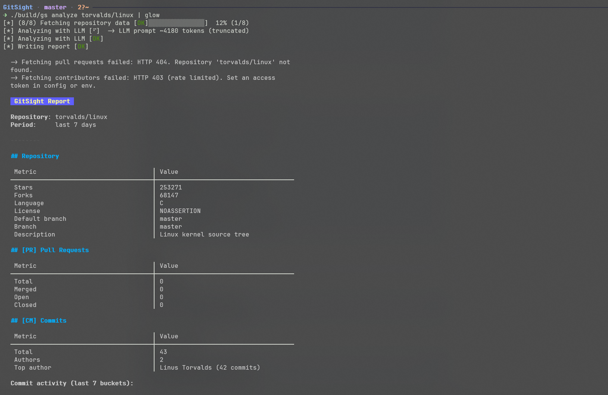
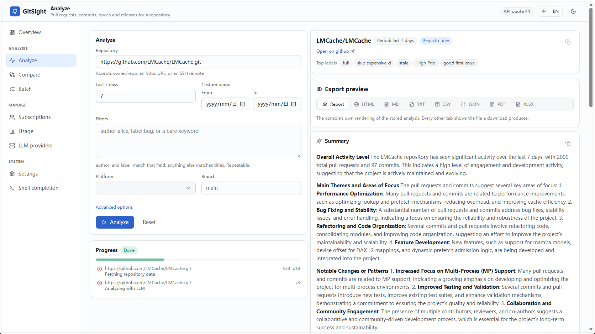

<h1 align="center">GitSight</h1>

<p align="center">
  
  
  
  
  
  
</p>

<p align="center">
  English | <a href="README.zh-CN.md">中文</a>
</p>

Analyze any public GitHub repository — Pull Requests, Commits, Issues — and export structured reports in 7 formats with optional AI-powered summaries. A local web console (`gs serve`) puts the same engine behind a browser UI.

> 💡 Generate weekly reports or review a project's development over a custom time period to quickly understand how a repository is evolving.

## Showcase

<table>
  <tr>
    <th align="center">CLI</th>
    <th align="center">Web Console</th>
  </tr>
  <tr>
    <td align="center"></td>
    <td align="center"></td>
  </tr>
  <tr>
    <td align="center"><sub>Reports straight to the terminal, or to a file in any of the 7 formats</sub></td>
    <td align="center"><sub>The same run in the browser, with live progress and instant format switching</sub></td>
  </tr>
</table>

## Features

- **Multi-source analysis** — Fetches PRs, commits, and issues from GitHub, GitLab, Codeberg, Gitea and Forgejo
- **Web console** — `gs serve` drives the same engine from a browser, with live progress and instant format switching
- **LLM-powered summaries** — Plug in any OpenAI-compatible API (OpenAI, Ollama, OpenRouter, etc.)
- **7 export formats** — JSON, Markdown, Plain Text, HTML, CSV, XLSX, PDF (single or batch)
- **Fully configurable** — Section visibility, fonts, colors, column widths, page layout
- **Zero runtime deps on output** — PDF and XLSX generated natively, no external tools
- **Network-friendly** — HTTP proxy, API mirror, enterprise GitHub support
- **Fast, portable C17** — Single binary, no interpreter or VM required

## Table of Contents

- [Showcase](#showcase)
- [Installation](#installation)
- [Quick Start](#quick-start)
- [Usage](#usage)
- [Web Console](#web-console)
- [Export Formats](#export-formats)
- [Configuration](#configuration)
- [Documentation](#documentation)
- [Contributing](#contributing)
- [License](#license)

## Installation

### Dependencies

- C17 compiler (GCC >= 8 / Clang >= 10)
- CMake >= 3.14
- libcurl (HTTPS client)
- zlib (compression for XLSX/PDF output)
- Node.js >= 20 + npm (only to build the web console via `-DGITSIGHT_BUILD_WEB=ON`; the default C-only build does not need it)

> cJSON and miniz are [vendored](third_party) and compiled in, so no extra
> runtime libraries are needed to produce JSON, Markdown, XLSX or PDF exports.
> The built web console is bundled next to `gs`, so `gs serve` ships a UI with
> no separate web server.

### Install Build Dependencies

C toolchain + libraries (always required):

| Distro | Command |
|--------|---------|
| Debian / Ubuntu | `sudo apt install cmake gcc libcurl4-openssl-dev zlib1g-dev` |
| Fedora / RHEL | `sudo dnf install cmake gcc libcurl-devel zlib-devel` |
| Arch Linux | `sudo pacman -S cmake gcc curl zlib` |
| macOS (Homebrew) | `brew install cmake curl zlib` (curl & zlib ship with macOS) |
| Alpine | `apk add cmake gcc musl-dev libcurl-dev zlib-dev` |

Node.js 20+ (only needed to build the web console with `-DGITSIGHT_BUILD_WEB=ON`):

| Distro | Command |
|--------|---------|
| Debian / Ubuntu | `sudo apt install nodejs npm` (or use [NodeSource](https://github.com/nodesource/distributions) for a current Node) |
| Fedora / RHEL | `sudo dnf install nodejs npm` |
| Arch Linux | `sudo pacman -S nodejs npm` |
| macOS (Homebrew) | `brew install node` |
| Alpine | `apk add nodejs npm` |

### Build & Install

```bash
git clone https://github.com/Cyxuan0311/GitSight.git
cd gitsight
mkdir build && cd build
cmake .. -DCMAKE_BUILD_TYPE=Release
make -j$(nproc)
sudo make install          # → /usr/local/bin/gs

# Verify
gs version
```

## Quick Start

```bash
# Analyze a public repo (default: markdown to stdout)
gs analyze curl/curl

# Save as JSON
gs analyze rust-lang/rust -f json -o report.json

# Specify time period
gs analyze torvalds/linux --since 30

# XLSX / PDF output (requires -o)
gs analyze owner/repo -f xlsx -o report.xlsx
gs analyze owner/repo -f pdf -o report.pdf

# Multiple formats at once
gs analyze owner/repo -f json,md,pdf -o ./report

# With AI-powered analysis (requires LLM config)
gs analyze owner/repo
```

## Usage

### Authentication

```bash
export GITHUB_TOKEN=ghp_xxxxxxxxxxxx
# or
gs config --set-token ghp_xxxxxxxxxxxx
```

### Repository Formats

```
gs analyze curl/curl
gs analyze https://github.com/curl/curl
gs analyze https://github.com/curl/curl.git
gs analyze git@github.com:curl/curl.git
```

### Color Control

```bash
gs analyze owner/repo --color always      # Force ANSI colors
gs analyze owner/repo --color never       # Plain output
gs analyze owner/repo --color auto         # Default (enabled on TTY)
```

### Proxy & Mirror

```bash
gs analyze owner/repo --proxy http://127.0.0.1:7890
gs analyze owner/repo --api-base https://api.github.com
```

## Web Console

```bash
gs serve                  # → http://127.0.0.1:8787
```

`gs serve` puts the same analysis, export and configuration engine behind a
browser UI: nine pages covering analyze, compare, batch, subscriptions, LLM
usage and every `gs config --set` key. Progress streams to the browser over SSE
so a run can be cancelled mid-flight, and a finished analysis stays in memory,
so switching export format is a re-render rather than a refetch.

`gs serve` binds to loopback and has **no authentication** — it reads and writes
the config file holding your access tokens. Only pass `--host 0.0.0.0` on a
network you trust.

See [web/README.md](web/README.md) ([中文](web/README.zh-CN.md)) for the page
tour, build steps and console development setup. The HTTP API is documented in
[usage.md](docs/usage.md#http-api).

## Export Formats

| Format | Ext | Output | Configurable |
|--------|-----|--------|-------------|
| **JSON** | `.json` | stdout / file | — |
| **Markdown** | `.md` | stdout / file | Table width, section visibility |
| **Plain Text** | `.txt` | stdout / file | Table width, section visibility |
| **HTML** | `.html` | stdout / file | Self-contained page: inline CSS, state badges, links, TOC, activity chart |
| **CSV** | `.csv` | stdout / file | Block-partitioned tidy tables (metrics / pull_requests / commits / issues / releases) |
| **XLSX** | `.xlsx` | file only | Font, column widths, borders, sheet name |
| **PDF** | `.pdf` | file only | Margin, line height, colors, page size |

### Customize Export Output

```bash
# Hide a section
gs analyze owner/repo --export show_commits=false

# PDF layout & colors
gs analyze owner/repo -f pdf -o report.pdf \
  --color always \
  --export pdf.margin=40 \
  --export pdf.title_color=200,50,50 \
  --export pdf.line_height=1.6

# XLSX formatting
gs analyze owner/repo -f xlsx -o report.xlsx \
  --export xlsx.font_size=14 \
  --export xlsx.border=false \
  --export xlsx.sheet_name="Summary"
```

See [Export Configuration](docs/configuration.md) for all available options.

## Configuration

Configuration is stored in `~/.config/gitsight/config.json` (auto-created on `gs config`).

### LLM Providers

```json
{
  "llms": {
    "openai": {
      "api_key": "sk-xxx",
      "api_base": "https://api.openai.com/v1",
      "model": "gpt-4o-mini"
    },
    "local": {
      "api_key": "not-needed",
      "api_base": "http://localhost:11434/v1",
      "model": "llama3.2"
    }
  }
}
```

Switch providers:

```bash
gs analyze owner/repo --llm local
gs config --set-llm local          # persist
```

### Environment Variables

| Variable | Overrides |
|----------|-----------|
| `GITHUB_TOKEN` | GitHub token |
| `LLM_API_KEY` | Active LLM key |
| `HTTPS_PROXY` | Proxy URL |
| `NO_COLOR` | Disable colors |

## Shell Completion

Tab completion for bash, zsh, and fish is compiled into the `gs` binary. Print
a script for your shell with `gs completion <shell>`, then source or install it:

```bash
# bash
gs completion bash > ~/.config/gitsight/gs.bash
echo "source ~/.config/gitsight/gs.bash" >> ~/.bashrc

# zsh
gs completion zsh > ~/.config/gitsight/_gs
echo "fpath=($HOME/.config/gitsight \$fpath)" >> ~/.zshrc
exec zsh

# fish
gs completion fish > ~/.config/fish/completions/gs.fish
```

Completions respect your configuration: repository names come from the
`subscriptions` in `~/.config/gitsight/config.json` (or `--config <path>`), and
LLM names from the configured providers.

## Documentation

| Guide | Description |
|-------|-------------|
| [Installation](docs/installation.md) / [中文](docs/installation.zh-CN.md) | Build from source for all platforms |
| [Usage](docs/usage.md) / [中文](docs/usage.zh-CN.md) | Full command reference and examples |
| [Configuration](docs/configuration.md) / [中文](docs/configuration.zh-CN.md) | LLM, proxy, and export config |
| [Architecture](docs/architecture.md) / [中文](docs/architecture.zh-CN.md) | Code structure and extending GitSight |

## Contributing

PRs are welcome! See [Architecture](docs/architecture.md) for the codebase overview.

- Issue tracker: [GitHub Issues](https://github.com/Cyxuan0311/GitSight/issues)
- Format: Please open an issue before submitting large feature PRs

## License

MIT
